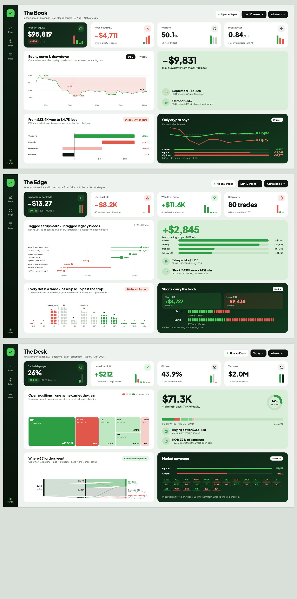

# Trading Analytics on Microsoft Fabric

A full trading analytics project: Alpaca paper trading and Binance market data go into a Microsoft Fabric lakehouse, move through a bronze → silver → gold medallion model, feed a Direct Lake semantic model, and end in a three-page dashboard built around data storytelling.



## The story in three pages
| Page | Question | Headline |
|---|---|---|
| **The Book** | Is the account growing? | −$4,711 net over 355 closed trades. Max drawdown −$9,831. Only crypto pays. |
| **The Edge** | Where do the wins and losses come from? | Expectancy −$13.27/trade. Shorts +$4,727, longs −$9,438. Losses run past the stop. |
| **The Desk** | What is open right now? | 26% of equity deployed, $71.3K in cash, 43.9% fill rate on 631 orders. |

## Architecture
```
Alpaca API / Binance ──► nb_bronze_api_pulls (Fabric notebook)
                           │  raw parquet → Files/raw/alpaca   (bronze)
                           │  Delta via OneLake abfss          (silver: trading.*)
                           ▼
                     gold_fact_* / gold_dim_*                  (gold)
                           ▼
              TradingSemanticModel (Direct Lake)
                           ▼
          Power BI report / HTML dashboard (Paper design)
```

## Repository layout
```
dashboard/
  html/          dashboard-replica.html (exact copy of the Paper design)
                 dashboard-guide-final.html (with the style guide applied)
  svg/           chart components (equity curve, waterfall, lollipop, sankey…)
  screenshots/   rendered PNGs
fabric/
  notebooks/     Delta write cell (abfss + bearer token)
  semantic-model/ model notes and to-dos
scripts/         Python generators for the SVG charts and HTML pages
docs/            style guide, Delta write fix write-up
```

## Tech
Microsoft Fabric (Lakehouse, Notebooks, SQL endpoint, Dataflow Gen2, Direct Lake) · Delta Lake (`deltalake`) · Python · Power BI · Paper (design) · SVG/HTML

## Notable engineering fix
Delta writes to `/lakehouse/default/Tables/` failed because the FUSE mount cannot do the atomic rename Delta needs. Writing through the OneLake `abfss://` endpoint with a storage bearer token fixed it. See [docs/delta-write-fix.md](docs/delta-write-fix.md).

## Rebuild the dashboard
```bash
python scripts/build_dash.py dashboard/html replica
python scripts/build_dash.py dashboard/html guide
```

## Roadmap
- Semantic model relationships and DAX measures
- Dataflow Gen2 transforms in Power Query
- Scheduled pipeline instead of manual Run all
- Backfill 14 crypto pairs from Binance

## Data
Paper trading only (Alpaca paper account), 27 Aug – 30 Oct 2026. No real money. API keys are not in this repo.
