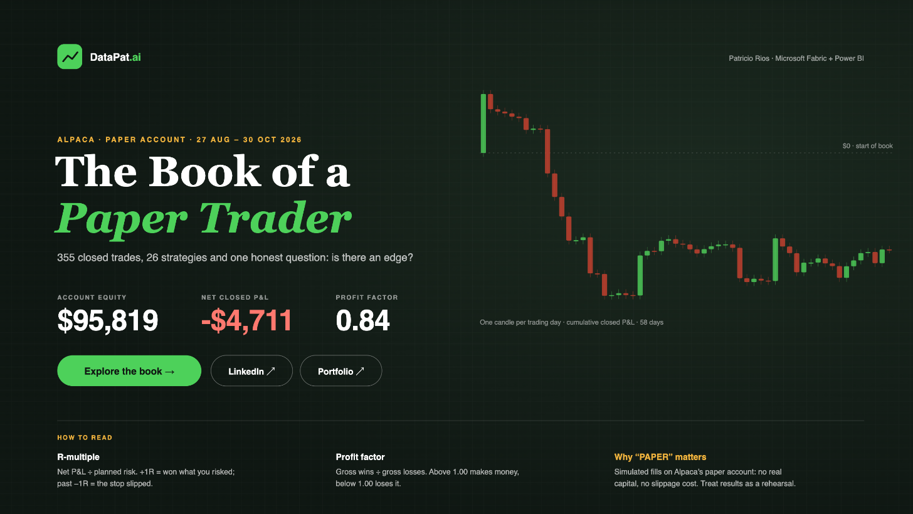
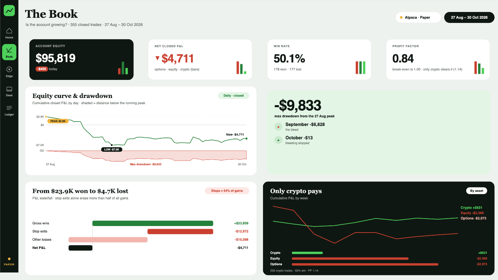
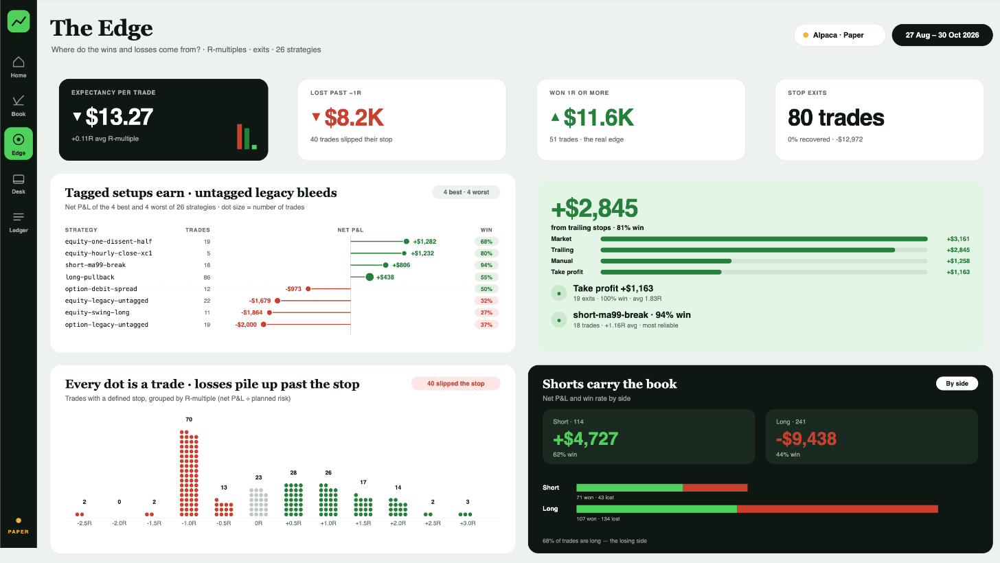
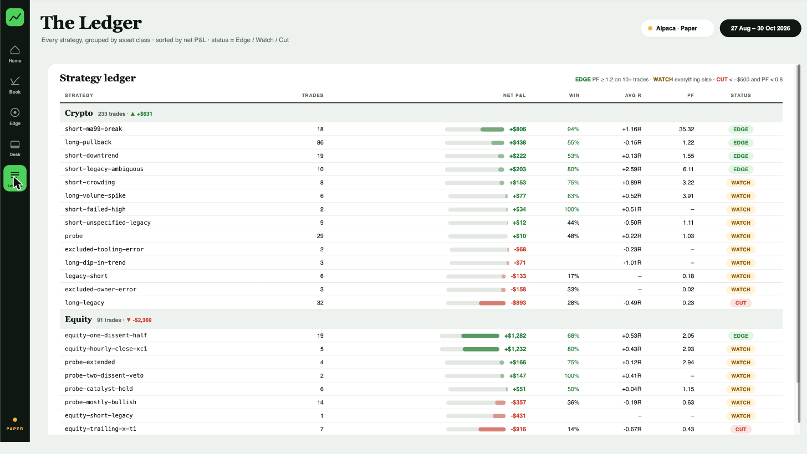

# Trading Analytics on Microsoft Fabric

A full trading analytics project: Alpaca paper trading and Binance market data go into a Microsoft Fabric lakehouse, move through a bronze → silver → gold medallion model, feed a Direct Lake semantic model, and end in a Power BI report built around data storytelling: a cover, three story pages and an explore page.

**[Open the live report (Publish to web)](https://app.powerbi.com/view?r=eyJrIjoiNDI0MGFmYWItMzRiMi00Njc5LTg2Y2UtZjdhMzcwYmJkMGUyIiwidCI6ImQxZmYwZmFmLTA5ZWItNDJjZi04MzEzLTA3MzNiM2Y3MDdkNyIsImMiOjR9)**



| The Book | The Edge |
|---|---|
|  |  |
| **The Desk** | **The Ledger** |
|  |  |

## The story in five pages
| Page | Question | Headline |
|---|---|---|
| **Cover** | What is this? | The Book of a Paper Trader: equity, net P&L, profit factor, a candle per trading day, and a how-to-read strip (R-multiple, profit factor, why PAPER matters). |
| **The Book** | Is the account growing? | −$4,711 net over 355 closed trades. Max drawdown −$9,831. Only crypto pays. |
| **The Edge** | Where do the wins and losses come from? | Expectancy −$13.27/trade. Shorts +$4,727, longs −$9,438. Losses run past the stop. |
| **The Desk** | What is open right now? | 26% of equity deployed, $71.3K in cash, 43.9% fill rate on 631 orders. |
| **The Ledger** | Explore it yourself | Every strategy by asset class with trades, net P&L heat bar, win rate, avg R, PF and an Edge / Watch / Cut status. |

## Design process
Wireframe (Paper) → **tokens** → components → assemble, benchmarked against the 2026 Dataviz World Champion report ([The World of Peaches](https://github.com/gusbavia/the-world-of-peaches)).
1. **Tokens.** One Python dict in `scripts/build_dax.py` (colour, type scale, radius, 8px spacing) generates the DAX measures, [`html/tokens.css`](html/tokens.css) and [`powerbi/trading-theme.json`](powerbi/trading-theme.json), so HTML, SVG and native visuals share the same values.
2. **Type.** Serif display (Georgia) for page and card titles, sans for labels, uppercase eyebrows, tabular figures for every number, nothing under 11–12px.
3. **Components.** KPI cards and panels are HTML measures; charts are SVG measures (equity curve with PEAK/LOW chips, waterfall, lollipop with win-rate chips, R-multiple dots, treemap, sankey).
4. **Assemble.** 1920×1080 pages, a dark rail with an active pill and an invisible Page navigator on top, header chips that state facts instead of fake dropdowns.
5. **Accessibility.** Gain/loss colours pass WCAG AA on white (#23803A 5.0:1, #C9402F 4.9:1), ▲▼ arrows so colour is never the only signal, and `Alt - *` measures for alt text.

See [docs/premium-upgrade.md](docs/premium-upgrade.md) for the full critique → fix log.

## Architecture
```
Alpaca API / Binance ──► nb_bronze_api_pulls (Fabric notebook)
                           │  raw parquet → Files/raw/alpaca   (bronze)
                           │  Delta via OneLake abfss          (silver: trading.*)
                           ▼
                     gold_fact_* / gold_dim_*                  (gold)
                           ▼
              TradingSemanticModel (Direct Lake)
                           ▼
          Power BI report / HTML dashboard (Paper design)
```

## Repository layout
```
dax/             146 DAX measures, one .dax file each (commented header), by page
  01-base/              core P&L, win rate, profit factor, drawdown
  02-page1-the-book/    page 1 measures
  03-page2-the-edge/    page 2 measures
  04-page3-the-desk/    page 3 measures
  05-html-cards/        KPI cards + insight panels (HTML Content visual)
  06-svg-visuals/       charts drawn in DAX as SVG (Image URL)
  07–09-page*-layout/   framed cards, headers and rail per page
  10-cover-and-ledger/  cover hero, ledger table, strategy status
  11-alt-text/          alt-text sentences for the main visuals
  _all-measures.dax     one script to load everything via DAX query view
powerbi/         trading-theme.json (generated from the tokens; hides visual headers, styles the canvas)
html/            tokens.css (same tokens for HTML components)
dashboard/
  html/          dashboard-replica.html (exact copy of the Paper design)
                 dashboard-guide-final.html (with the style guide applied)
  svg/           chart components (equity curve, waterfall, lollipop, sankey…)
  screenshots/   rendered PNGs
fabric/
  notebooks/     Delta write cell (abfss + bearer token)
  semantic-model/ model notes and to-dos
scripts/         Python generators for the SVG charts and HTML pages
docs/            style guide, Delta write fix write-up
```

## Tech
Microsoft Fabric (Lakehouse, Notebooks, SQL endpoint, Dataflow Gen2, Direct Lake) · Delta Lake (`deltalake`) · Python · Power BI · Paper (design) · SVG/HTML

## Notable engineering fix
Delta writes to `/lakehouse/default/Tables/` failed because the FUSE mount cannot do the atomic rename Delta needs. Writing through the OneLake `abfss://` endpoint with a storage bearer token fixed it. See [docs/delta-write-fix.md](docs/delta-write-fix.md).

## Build the Power BI report
Follow [docs/report-build-guide.md](docs/report-build-guide.md): relationships, loading `dax/_all-measures.dax`, and which measure goes in each visual on each page.
Regenerate the DAX with `python scripts/build_dax.py .`

## Rebuild the HTML dashboard
```bash
python scripts/build_dash.py dashboard/html replica
python scripts/build_dash.py dashboard/html guide
```

## Roadmap
- Save as PBIP and commit the TMDL + report JSON
- Field-parameter page controls (Asset / Grain, Cut) and report-page tooltips
- Bookmark-based "How to read" overlay on every page
- Dataflow Gen2 transforms in Power Query
- Scheduled pipeline instead of manual Run all
- Backfill 14 crypto pairs from Binance

## Data
Paper trading only (Alpaca paper account), 27 Aug – 30 Oct 2026. No real money. API keys are not in this repo.
