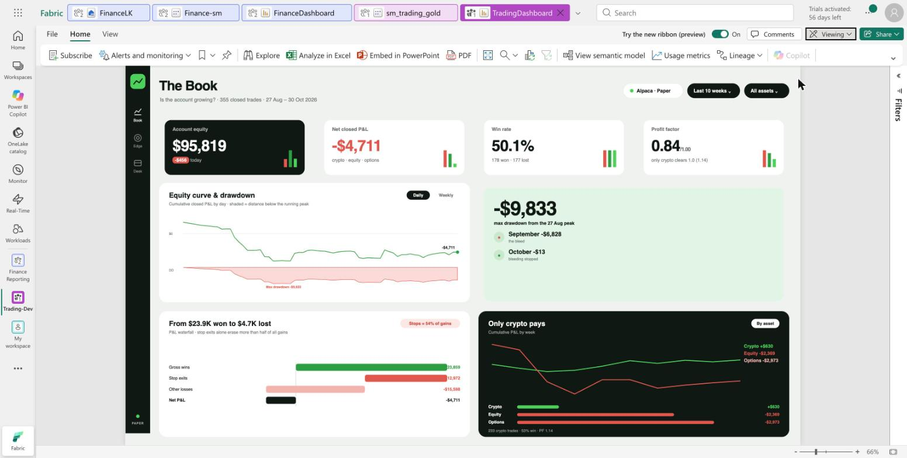
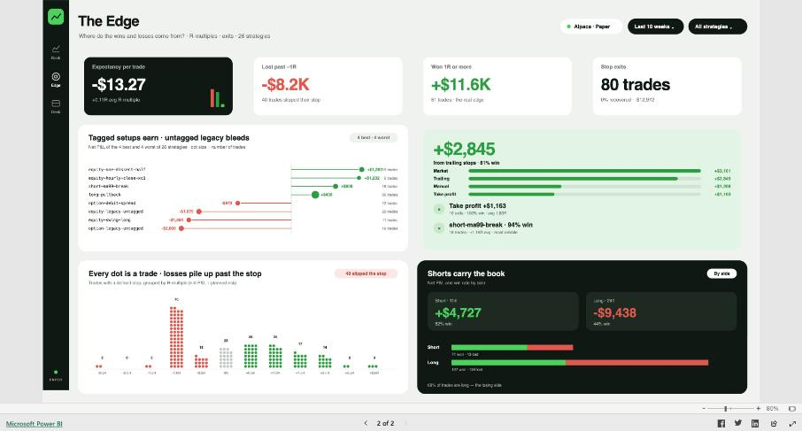
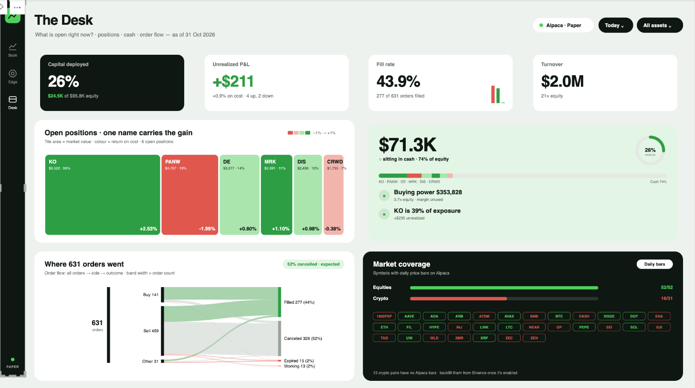

# Power BI report build guide

How to rebuild the three dashboard pages (`dashboard/html/dashboard-replica.html`) in Power BI with the measures in `dax/`.

## 1 · Model set-up (Direct Lake model `sm_trading_gold`)

**Relationships** (one-to-many, single direction):

| From (one) | To (many) |
|---|---|
| `gold_dim_date[Date]` | `gold_fact_trades[Date]`, `gold_fact_orders[Date]`, `gold_fact_account[Date]`, `gold_fact_positions[Date]`, `gold_fact_prices_daily[Date]` |
| `gold_dim_symbol[symbol]` | `gold_fact_trades[symbol]`, `gold_fact_orders[symbol]`, `gold_fact_positions[symbol]`, `gold_fact_prices_daily[symbol]` |
| `gold_dim_strategy[strategy]` | `gold_fact_trades[strategy]` |

Mark `gold_dim_date` as the date table.

**Direction matters:** every date relationship must be fact (*) → `gold_dim_date` (1). If it is the other way round, month/week filters never reach the facts (symptoms: flat equity curve, September and October both showing the full-period total).

**Load the measures:** copy the script with a UTF-8 clipboard (`LC_ALL=en_US.UTF-8 pbcopy < dax/_all-measures.dax` on macOS, otherwise `·` and `–` turn into `¬∑`), then open Power BI Desktop (live-edit the model) → **DAX query view** → paste `dax/_all-measures.dax` → **Run** → **Update model with changes**. Then put each measure in the display folder named in its header (`01-base`, `02-page1-the-book`, …).
Set **Data category = Image URL** on every `SVG - …` measure.

**Theme:** View → Themes → Browse → `powerbi/trading-theme.json`.

**Label clean-up note:** the gold data mixes `Stop`/`stop`, `Long`/`LONG`, `Short`/`SHORT`. DAX text comparison is case-insensitive, so the measures already group them correctly. `Trailing` + `trailing_stop` and `Manual` + `Manual_App` are combined with `IN { … }`.

## 2 · Visual types

| Measure type | Visual |
|---|---|
| `Card - … HTML`, `Panel - … HTML` | **HTML Content** custom visual (AppSource), measure in *Values* |
| `SVG - …` | **Image** visual (*Image URL* = measure), the new **Card** visual image slot, or a single-cell table |
| plain measures | native visuals (cards, bar, line, table) |

## 3 · Page 1 · The Book — *Is the account growing?* (built)

Page 1 is built in the `TradingDashboard` report on a 1920×1080 grid. Charts, header and rail are **Image** visuals (Image source = *Select from data*, fit = *Fit*) bound to the framed SVG measures in `dax/07-page1-layout`. KPI cards and the drawdown panel are **HTML Content** visuals with visual background off and padding 0.

| Visual | Measure | x | y | w | h |
|---|---|---|---|---|---|
| Rail | `SVG - Rail` | 0 | 0 | 72 | 1080 |
| Header | `SVG - Header The Book` | 96 | 24 | 1792 | 96 |
| KPI 1–4 | `Card - Account Equity / Net Closed P&L / Win Rate / Profit Factor HTML` | 96 / 550 / 1004 / 1458 | 140 | 430 | 170 |
| Equity curve | `SVG - Card Equity Curve` | 96 | 334 | 884 | 340 |
| Drawdown panel | `Panel - Max Drawdown HTML` | 1004 | 334 | 884 | 340 |
| Waterfall | `SVG - Card Waterfall` | 96 | 698 | 884 | 358 |
| Crypto vs equity | `SVG - Card Crypto` | 1004 | 698 | 884 | 358 |

Original slot plan:

| Slot (dashboard) | Visual | Measures |
|---|---|---|
| Title / subtitle | Text box with dynamic value or Card (new) | `Title - The Book`, `Subtitle - The Book` |
| KPI 1 (dark) | HTML Content | `Card - Account Equity HTML` |
| KPI 2 | HTML Content | `Card - Net Closed P&L HTML` |
| KPI 3 | HTML Content | `Card - Win Rate HTML` |
| KPI 4 | HTML Content | `Card - Profit Factor HTML` |
| Equity curve & drawdown | Image | `SVG - Equity Curve & Drawdown` — *native alternative:* line chart, X = `gold_dim_date[Date]`, Y = `Cumulative P&L`, + area chart of `Drawdown` |
| Max drawdown panel (mint) | HTML Content | `Panel - Max Drawdown HTML` |
| P&L waterfall | Image | `SVG - P&L Waterfall` (uses `Gross Wins`, `Stop Exit P&L`, `Other Losses`, `Net P&L`) |
| Only crypto pays (dark) | Image | `SVG - Crypto vs Equity Weekly` — *native:* line chart, X = `WeekStart`, Y = `Cumulative P&L`, legend = `asset_class` |

## 4 · Page 2 · The Edge — *Where do wins and losses come from?* (built)

Built in `TradingDashboard - Public` by duplicating page 1 (same grid and slots) and rebinding each visual:

| Slot (same position as page 1) | Measure |
|---|---|
| Rail | `SVG - Rail The Edge` |
| Header | `SVG - Header The Edge` |
| KPI 1–4 | `Card - Expectancy HTML`, `Card - Lost Past -1R HTML`, `Card - Won 1R+ HTML`, `Card - Stop Exits HTML` |
| Row 2 left | `SVG - Card Strategy Lollipop` |
| Row 2 right | `Panel - Trailing Stops HTML` (exit bars + best strategy) |
| Row 3 left | `SVG - Card R-Multiple Dots` |
| Row 3 right | `SVG - Card Shorts vs Longs` |

Original slot plan:

| Slot | Visual | Measures |
|---|---|---|
| Title | Card (new) | `Title - The Edge` |
| KPI 1 (dark) | HTML Content | `Card - Expectancy HTML` |
| KPI 2 | HTML Content | `Card - Lost Past -1R HTML` |
| KPI 3 | HTML Content | `Card - Won 1R+ HTML` |
| KPI 4 | HTML Content | `Card - Stop Exits HTML` |
| Strategy lollipop | Image | `SVG - Strategy Lollipop` — *native:* bar chart, axis = `strategy`, value = `Net P&L`, visual filter `Strategy Top-Bottom 4 Filter = 1` |
| Trailing stops panel (mint) | HTML Content + bar chart | `Panel - Trailing Stops HTML`; bars: `Market Exit P&L`, `Trailing P&L`, `Manual Exit P&L`, `Take Profit P&L` |
| R-multiple dots | Image | `SVG - R-Multiple Dots` |
| Shorts carry the book (dark) | HTML Content + Image | `Panel - Shorts vs Longs HTML`, `SVG - Long vs Short Units` |

## 5 · Page 3 · The Desk — *What is open right now?* (built)

Duplicated from The Edge and rebound:

| Slot | Measure |
|---|---|
| Rail / Header | `SVG - Rail The Desk`, `SVG - Header The Desk` |
| KPI 1–4 | `Card - Capital Deployed HTML`, `Card - Unrealized P&L HTML`, `Card - Fill Rate HTML`, `Card - Turnover HTML` |
| Row 2 left | `SVG - Card Positions Treemap` |
| Row 2 right | `Panel - Cash HTML` (cash, invested donut, exposure strip) |
| Row 3 left | `SVG - Card Order Flow` (Sankey) |
| Row 3 right | `SVG - Card Market Coverage` (bars + one chip per crypto pair) |

Original slot plan:

| Slot | Visual | Measures |
|---|---|---|
| Title | Card (new) | `Title - The Desk` |
| KPI 1 (dark) | HTML Content | `Card - Capital Deployed HTML` |
| KPI 2 | HTML Content | `Card - Unrealized P&L HTML` |
| KPI 3 | HTML Content | `Card - Fill Rate HTML` |
| KPI 4 | HTML Content | `Card - Turnover HTML` |
| Open positions treemap | Image | `SVG - Positions Treemap` — *native:* treemap, group = `gold_fact_positions[symbol]`, values = `Position Market Value`, colour (fx) = `Position Return %` |
| Cash panel (mint) | HTML Content + Image | `Panel - Cash HTML`, `SVG - Cash Donut` |
| Where orders went | Image | `SVG - Order Flow Sankey` |
| Market coverage (dark) | Image | `SVG - Market Coverage` |

## 6 · Expected values (27 Aug – 30 Oct 2026), checked against the SQL endpoint

| Measure | Value |
|---|---|
| Trades / Net P&L | 355 / −$4,711 |
| Gross Wins / Gross Losses | $23,859 / −$28,570 |
| Win Rate / Profit Factor | 50.1% / 0.84 |
| Stop Exit P&L / Stop Exits | −$12,972 / 80 |
| Lost Past −1R | −$8,231 · 40 trades |
| Won 1R+ | +$11,607 · 51 trades |
| Trailing P&L | +$2,845 |
| Crypto / Equity / Options P&L | +$631 / −$2,369 / −$2,973 |
| Account Equity / Cash / Buying Power | $95,819 / $71,279 / $353,828 |
| Unrealized P&L | +$211 |
| Orders / Filled / Canceled / Expired / Working | 631 / 277 / 326 / 15 / 13 |
